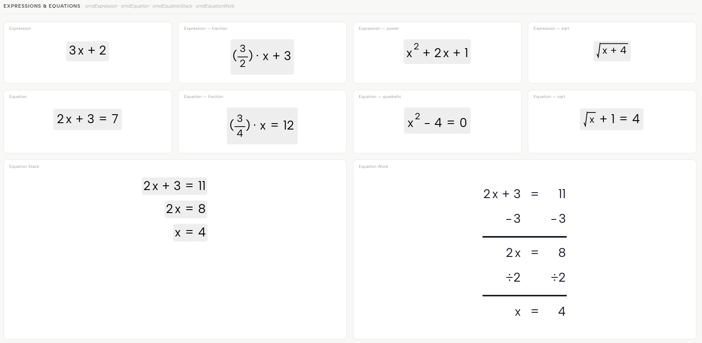
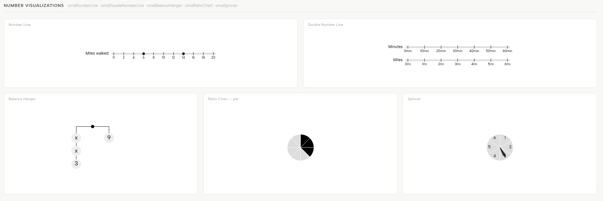
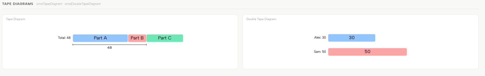
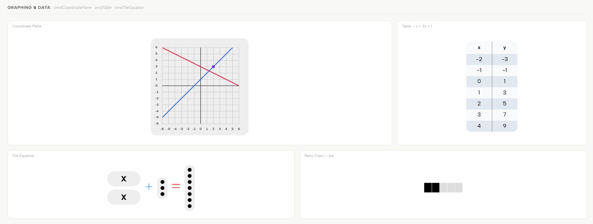
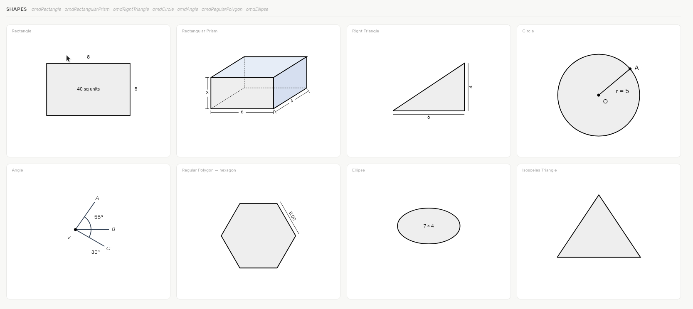

# OMD

A JavaScript library for rendering mathematical visualizations and expressions as SVG.

## Installation

```bash
npm install @teachinglab/omd
```

## Getting Started

```js
import { omdDisplay } from '@teachinglab/omd';

const display = new omdDisplay(document.getElementById('container'));

// Render a math string
display.render('3*x + 2');

// Render any visualization from JSON — one line
display.loadFromJSON({ omdType: 'numberLine', min: 0, max: 10, dotValues: [3, 7] });
```

## Quick Start

```js
import { omdDisplay, omdNumberLine } from '@teachinglab/omd';

// Render an expression
const display = new omdDisplay(document.getElementById('container'));
display.render('3*x + 2');          // expression
display.render('2*x + 3 = 7');      // equation (auto-detected by =)

// Render a visualization from JSON
display.loadFromJSON({ omdType: 'numberLine', min: 0, max: 10, dotValues: [3, 7] });

// Or build a component and load it
const line = new omdNumberLine();
line.loadFromJSON({ min: 0, max: 10, dotValues: [3, 7] });
display.load(line);
```

## Core Concepts

### omdDisplay

Renders a single component into a DOM container. The SVG sizes to fit the content and is aligned within the container.

```js
const display = new omdDisplay(container, {
    alignment: 'center',   // 'center' | 'left' | 'right' (default: 'center')
    autoScale: true,       // shrink to fit if too large (default: true)
    maxScale: 1,           // never upscale past natural size (default: 1)
    padding: 8,            // padding around content in px (default: 8)
});

display.render('sqrt(x + 4)');                                      // string → auto-detected
display.loadFromJSON({ omdType: 'numberLine', min: 0, max: 10 });   // from JSON
display.load(myVisual);                                             // pre-built component
display.clear();
display.destroy();
```

### omdCanvas

A multi-object stage. Add components at explicit positions.

```js
const canvas = new omdCanvas(document.getElementById('stage'), {
    width: 1100,
    height: 500,
});

const plane = new omdCoordinatePlane();
plane.loadFromJSON({ xMin: -5, xMax: 5, yMin: -5, yMax: 5 });

// Position via add options
canvas.add(plane, { x: 30, y: 40 });

// Or position beforehand — equivalent
plane.setPosition(30, 40);
canvas.add(plane);

const eq = new omdEquation();
eq.loadFromJSON('2*x + 3 = 7');
canvas.add(eq, { x: 400, y: 200, scale: 1.5 });

canvas.move(plane, 60, 40);
canvas.remove(eq);
canvas.clear();
```

## Components

### Expressions & Equations



| Class | Description | Example input |
|---|---|---|
| `omdExpression` | Math expression | `'3*x + 2'` or `{ expression: '3*x+2', fontSize: 24 }` |
| `omdEquation` | Equation with `=` | `'2*x + 3 = 7'` or `{ equation: '...', fontSize: 24 }` |
| `omdEquationStack` | Stacked equations aligned by `=` | `{ equations: ['2x+3=7', '2x=4', 'x=2'] }` |
| `omdEquationWork` | Step-by-step worked solution | `{ rows: [{kind:'equation', left:'2x+3', right:'7'}, ...] }` |

All expression/equation components support:
```js
expr.setBackgroundColor('#fff');      // set background color
expr.hideBackgroundByDefault();       // transparent background
```

### Number Visualizations



| Class | Description |
|---|---|
| `omdNumberLine` | Number line with optional dot markers |
| `omdDoubleNumberLine` | Two parallel number lines |
| `omdBalanceHanger` | Balance scale with variables and numbers |
| `omdRatioChart` | Pie, dot, or bar ratio chart |
| `omdSpinner` | Circular spinner with divisions |

### Tape Diagrams



| Class | Description |
|---|---|
| `omdTapeDiagram` | Part-whole tape diagram |
| `omdDoubleTapeDiagram` | Two stacked tape diagrams |

### Fraction Models

| Class | Description |
|---|---|
| `omdAreaDiagram` | Area model with fractional side lengths; shadeable, draggable, answerable |
| `omdAreaModel` | Not-to-scale partial-products area model — mixed × mixed or multi-digit whole numbers, with a sum line |
| `omdFractionStrips` | Equal-sharing strips — `a ÷ b` and `a × 1/b` on one diagram |
| `omdFractionCircle` | Circles cut into equal wedges |

Lengths accept `4`, `'2/3'` and `'3 1/4'` and stay exact, so a 3 1/4 by 4 rectangle
reports an area of 13. See [`docs/visualizations.md`](docs/visualizations.md) and the
Grade 5 Unit 2 gallery in `examples/g5-unit2/`.

### Algorithms & Prose

| Class | Description |
|---|---|
| `omdAlgorithmWork` | US standard algorithms on a place-value grid, with step-by-step reveal |
| `omdFractionWork` | Fraction ×, ÷, +, − worked line by line from the operands alone, with step-by-step reveal |
| `omdFractionAreaModel` | “a/b of c/d” built up on a unit square in three captioned panels |
| `omdMathText` | Prose with typeset math inline, rendered as translatable HTML — `\( 4x + 2 \)`, `\( \frac{3}{4} \)`, `[3/4]`, `2 5/8`, `**bold**` |

### Graphing & Data



| Class | Description |
|---|---|
| `omdCoordinatePlane` | 2D graph — plot equations, points, segments |
| `omdTable` | Data table from an equation or manual data |
| `omdTileEquation` | Algebra tile equation |
| `omdLinePlot` | Dot/line plot with stacked marks over a fraction-aware axis |

### Shapes



| Class | Description |
|---|---|
| `omdRectangle` | Rectangle with dimension labels |
| `omdRectangularPrism` | 3D rectangular prism; `showUnitCubes` renders it as stacked unit cubes |
| `omdRightTriangle` | Right triangle |
| `omdIsoscelesTriangle` | Isosceles triangle |
| `omdCircle` | Circle with optional points and segments |
| `omdEllipse` | Ellipse |
| `omdAngle` | Angle diagram with rays and arc markers |
| `omdRegularPolygon` | Regular polygon (triangle, hexagon, etc.) |

## Examples

### Number Line

```js
import { omdDisplay, omdNumberLine } from '@teachinglab/omd';

const line = new omdNumberLine();
line.loadFromJSON({
    min: 0,
    max: 20,
    increment: 2,
    dotValues: [6, 14],
    title: 'Miles walked',
});

new omdDisplay(document.getElementById('line-container')).load(line);
```

### Coordinate Plane

```js
import { omdCoordinatePlane } from '@teachinglab/omd';

const plane = new omdCoordinatePlane();
plane.loadFromJSON({
    xMin: -10, xMax: 10,
    yMin: -10, yMax: 10,
    graphEquations: [
        { equation: 'y = x^2 - 4', color: '#e11d48' },
        { equation: 'y = 2*x + 1', color: '#0f766e' },
    ],
    dotValues: [[2, 0, '#e11d48']],
});
```

### Balance Hanger

```js
import { omdBalanceHanger } from '@teachinglab/omd';

const hanger = new omdBalanceHanger();
hanger.loadFromJSON({
    leftValues: ['x', 'x', '3'],
    rightValues: ['9'],
});
```

### Rectangle with Labels

```js
import { omdRectangle } from '@teachinglab/omd';

const rect = new omdRectangle();
rect.loadFromJSON({
    width: 8,
    height: 5,
    unitScale: 40,
    showLabels: true,
    centerLabel: '40 sq ft',
});
```

### Equation Work

```js
import { omdEquationWork } from '@teachinglab/omd';

const work = new omdEquationWork();
work.loadFromJSON({
    rows: [
        { kind: 'equation', left: '2x + 3', right: '11' },
        { kind: 'operation', left: '-3', right: '-3' },
        { kind: 'line' },
        { kind: 'equation', left: '2x', right: '8' },
        { kind: 'operation', left: '÷2', right: '÷2' },
        { kind: 'line' },
        { kind: 'equation', left: 'x', right: '4' },
    ],
});
```

### Factory Function

All components can be created from a JSON object using `createFromJSON`. The JSON structure is flat — the same object you pass to the factory is what `loadFromJSON` expects on each class directly.

```js
import { createFromJSON } from '@teachinglab/omd';

// All fields are at the top level alongside omdType
const visual = createFromJSON({
    omdType: 'numberLine',
    min: 0,
    max: 10,
    dotValues: [3, 7],
});

// This is equivalent to:
const line = new omdNumberLine();
line.loadFromJSON({ omdType: 'numberLine', min: 0, max: 10, dotValues: [3, 7] });

// Or render directly via omdDisplay.loadFromJSON — one line:
display.loadFromJSON({ omdType: 'numberLine', min: 0, max: 10, dotValues: [3, 7] });
```

### Inline math in prose (`@teachinglab/omd/text`)

Word problems need fractions and expressions set inside the sentence, and the sentence
needs to stay translatable — Chrome's page translator only rewrites HTML text nodes, never
SVG `<text>`. The grammar and its HTML renderer therefore ship as a standalone entry point
with no SVG, no jsvg and no DOM access at import time, so React and SSR consumers can use
them directly. The `mathText` component renders the exact same markup on canvas.

```js
import {
    parseInlineMath,          // string -> inline AST (prose runs + math runs)
    renderInlineMathToHTML,   // string -> HTML; math runs carry translate="no"
    renderInlineMathToDOM,    // string -> DocumentFragment
    inlineMathToPlainText,    // string -> linear text for TTS/grading: "3/4", "x^2"
    INLINE_MATH_CSS,          // stylesheet for the emitted classes
} from '@teachinglab/omd/text';

renderInlineMathToHTML(String.raw`Solve \( 4x + 2 = 10 \), then divide by 2 5/8.`);
```

Markup: `\( ... \)` LaTeX subset (`\frac`, `a/b`, `x^2`, `a_1`, `\sqrt`, `\times`, `\div`,
`\le`, `\pi`, `\text{...}`), legacy `[3/4]` / `[2 3/4]` / `[6]` tokens, bare `3/4` and
`2 5/8` in prose, `**bold**`, and `\n`. See [Visualizations → mathText](docs/visualizations.md#mathtext).

## Documentation

- [Canvas classes (omdDisplay, omdCanvas)](docs/canvas.md)
- [Expressions & equations](docs/expressions.md)
- [Visualizations](docs/visualizations.md)
- [Shapes](docs/shapes.md)

## Dependencies

- [`@teachinglab/jsvg`](https://www.npmjs.com/package/@teachinglab/jsvg) — SVG rendering
- [`mathjs`](https://mathjs.org) — Expression parsing
